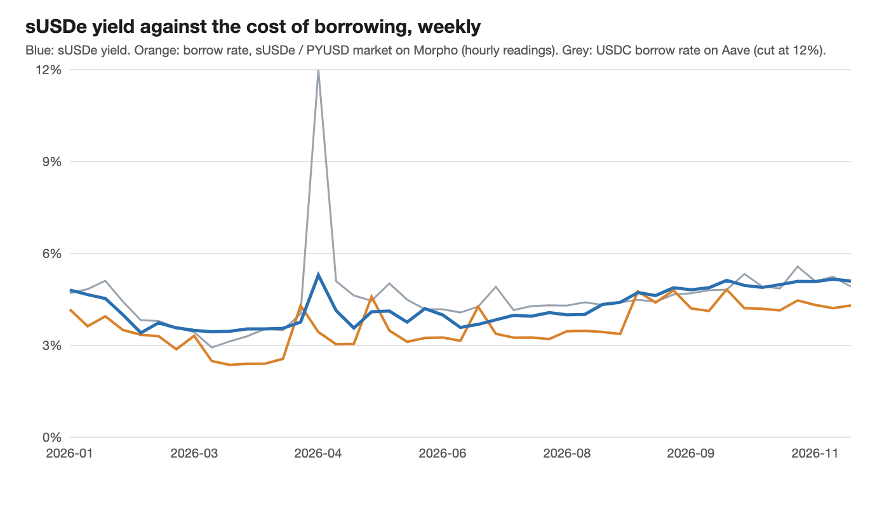
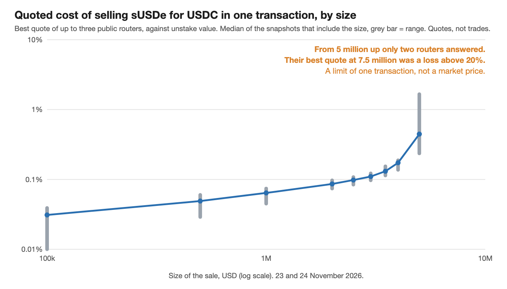
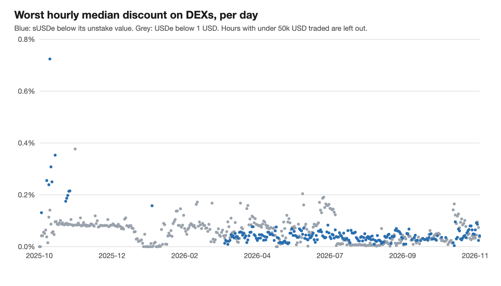

# How holders leave a leveraged sUSDe position, and what the exit by sale would cost

A study of the sUSDe / PYUSD lending market on Morpho (Ethereum). Data taken on 23 November 2026.

`python3 code/analyze.py` recomputes the numbers below from the saved inputs in `data/raw` and writes `data/results.json`. The key in brackets after a number is its name in that file. Dune results are saved aggregates of the SQL in `queries/`. Every query that reads the whole life of the market, or that used the run date, stops at 24 November 2026 00:00:00 UTC, so a rerun reads the same events. The eighteen queries with that bound were rerun on 24 November and their results saved. Two things can still move on a rerun. Between the run of 23 November and the rerun, 52 daily USDe values of query 01 moved (the largest, the worst-tenth price of 31 July 2026, from 61.7 to 1.8 bp) and the two medians of query 19 moved by 0.2 and 0.4 hours. Those values use Dune's approximate percentile over `dex.trades`, and whether the function or a revision of the table moved them was not separated. No number in `data/results.json` outside those two medians changed with them. `cex.addresses`, the exchange label table of queries 15 and 16, has no time bound. The public runs of 24 November (links under "Reproduce") returned the saved values, with these exceptions: the approximate USDe columns of query 01 on 47 days (by at most 2.4 bp), the two medians of query 19 (1.83 and 12.72 hours against 1.62 and 12.83 saved), the two approximate medians of query 06 (5.80 and 3.02 million against 5.94 and 3.10 saved), and one count in query 16, the repayments in the row "not covered" (9 against 8 saved, with the same amount). Position rows are not in the repo (see "Who is in the market").

## Terms

- **USDe**: Ethena's dollar token. **sUSDe**: staked USDe. It earns Ethena's yield and can be turned back into USDe by an unstake: a request, then a fixed wait (the contract calls it the cooldown), then a claim.
- **Unstake value**: what one sUSDe gives back in USDe at the contract rate, with 1 USDe counted as 1 USD.
- **Morpho**: a lending protocol. In the sUSDe / PYUSD market a holder posts sUSDe as collateral and borrows PYUSD, a dollar stablecoin.
- **Loop**: borrow, buy more sUSDe, post it, borrow again. Leverage of 7x means 7 USD of sUSDe for each 1 USD of equity.
- **LLTV**: the loan-to-value ratio above which a position can be liquidated, 91.5% here.
- **Oracle, price feed**: the contract that tells the market what the collateral is worth, and the published prices it reads.
- **Carry**: yield earned minus interest paid.
- **DEX**: decentralized exchange. **CEX**: centralized exchange. **bp**: basis point, 0.01%.
- **Utilization**: debt divided by supply in the lending market. Above 90% the borrow rate rises steeply.

## Result

Observed. From January to 23 November 2026, 392 million sUSDe (about 494 million USD at today's rate) was withdrawn from the market in 636 transactions [`exits_whole_life`].

- The receiving addresses started Ethena unstakes worth 40% of it within three days, and 33% by a stricter counting rule. Each address is capped at what it received, so an address that received 100 and unstaked 1 counts as 1. This is not the share of withdrawn sUSDe whose receiver started an unstake: 40 of the 101 receivers made a request within three days. These are two counting rules, not an error band (see below).
- By the same two rules, the receiving addresses sold 5.7% or 5.2% of it on a DEX or through CoW Protocol within three days. These are sales by the receiving address, capped per address at what it received (22.37 and 20.35 of 392.26 million sUSDe), not traced coins. On DEXs alone: 4.7% or 4.2%. Within seven days 5.9%, at any later time 8.9% [`receivers_sales`, `queries/25_receivers_susde_sold.sql`]. 41 of the 101 receivers sold something within three days, 3 of them through CoW. What stays invisible: a sale by another address of the same holder, a private quote, a venue outside Dune's `dex.trades` and CoW tables.
- 2% of it (1.8%) left in a transaction that also sold sUSDe on a DEX [`exits_whole_life.share_with_dex_sale_same_tx`]. This is the narrower, same-transaction measure. Every "2%" in this study is this figure.
- 84% left in a transaction that also repaid debt in the same market. 348 million PYUSD was repaid in those transactions. This is mechanics, not a choice: at a mean loan-to-value of 86.5% against a limit of 91.5%, collateral cannot leave without a repayment. The 84% includes the 2%.
- Within one day the receiving addresses started unstakes worth 34% of the withdrawn sUSDe (the start of an unstake into USDe, followed by the unstake wait, not a queue). Within three days: 40%. Within seven: 42%. At any later time: 66% [`exit_paths`, `queries/10_exit_paths.sql`]. A stricter match, capped at what the address received on that withdrawal day, gives 31% within one day and 33% within three [`queries/11_exit_paths_strict.sql`]. Most of this sUSDe left in a transaction that had already repaid debt, so the unstake is what was done with freed collateral. It does not show what paid the loan. Unstaking gives USDe, which still has to be sold for dollars. This matches addresses, not coins. An address can unstake sUSDe it got elsewhere, and forwarded sUSDe is not followed. The 33% and the 40% are two counting rules for the same three days, not an error band. The 40% caps the match at what an address received from the market over its whole life. The 33% caps it at what the address received on that withdrawal day. Neither is a lower bound on coins.
- 101 addresses received the withdrawn collateral. The ten largest receivers got 80%. They are not necessarily the same set as the ten addresses that cut their debt ("Who made the fall") or the ten largest positions today ("Who is in the market").
- 14 of the 101 are contracts. They received 12% of the sUSDe, made no unstake request within three days and sent 94% of it on within three days. That sUSDe is not followed [`receivers_check`, `queries/24_receivers_and_usde_sold.sql`].
- Receivers sent on up to 69% of what they received within three days, by the same address-level cap. That cap and the unstake cap overlap, since an address also moves sUSDe it got elsewhere, so the two shares do not add up.
- The 61 receiving addresses that claimed USDe sold 30% of it on a DEX within three days of a claim [`receivers_check.share_of_claimed_usde_sold_on_dex_within_3d`]. The denominator is the 552.6 million USDe they claimed from Ethena's unstake silo, more than the market's withdrawals alone would give, so it includes sUSDe from elsewhere. A sale is matched on the transaction sender (`tx_from`): a sale sent by a Safe, a contract or another address is not seen.
- 21 withdrawals were larger than 4 million sUSDe (about 5 million USD). They carry 36% of the total. None came with a DEX sale.
- None came with an unstake request or a deposit into another Morpho market in the same transaction.

Where the repaid PYUSD came from is traced one step back in "How the large unwind went". A later sale by the receiving address is counted in `receivers_sales`. A sale by another address or outside Dune's `dex.trades` and CoW tables is not seen.

Quoted, not traded. On 23 and 24 November 2026 three public routers were asked to price a sale of sUSDe for USDC in one transaction. The best quote stayed under 0.5% of unstake value at every size quoted up to 3 million USD, in every snapshot. At 4 million it also stayed under 0.5%, but without the CoW estimate that holds in 5 of 7 snapshots, and in the other 2 the only alternative was KyberSwap at about 10.4% and 10.9%. The best quote showed a loss above 20% at 7.5 million in every snapshot that included that size [`quotes.sUSDe_to_USDC_7_5m_loss_above_pct`]. This measures the depth of DEX pools inside one transaction. It is not the price of a sale split over hours, of a private quote, or of a buyer who unstakes the next day.

## Where the loop wins

Observed, weekly means, 45 weeks from 13 January to 23 November 2026, starting when the market had more than 1 million USD of debt. The borrow rate is the mean of 24 hourly readings per day [`carry_morpho_hourly`, `data/raw/morpho_borrow_hourly.json`]:

| | |
|---|---|
| Weeks with sUSDe yield below the Morpho borrow rate | 4 of 45 |
| Days with sUSDe yield below the Morpho borrow rate | 36 of 316 |
| Mean of yield minus borrow rate, all 45 weeks | 0.62 points |
| Mean over the 41 weeks with yield above [`carry_morpho_hourly.mean_spread_points_weeks_above`] | 0.72 points |
| Range of the weekly difference | -0.58 to +1.86 points |
| Daily mean of the borrow rate, lowest and highest | 2.30% to 8.74% |
| Weeks below the USDC borrow rate on Aave [`carry_aave_usdc`] | 27 of 45 |

- The four weeks below end on 20 April, 18 May, 29 June and 31 August 2026. The 31 August week is below by 0.035 points.
- The count depends on where a week starts. Over the seven possible starts it runs from 3 to 6 weeks, of 44 or 45 [`carry_morpho_hourly_by_week_start`].
- The week start used is 13 January. Weeks are blocks of seven days counted back from the last day of data, 23 November, and the one day left over at the start, 12 January, is dropped.
- On one reading a day at 00:00 UTC, the Morpho API's daily series, the count is 2 of 45 (43 of 45 above), the mean 0.60 points and the highest daily reading 17.6% [`carry_morpho`]. A single reading can miss or catch a spike of a few hours.
- Incentives: on the borrow side the API shows none on any of 317 days. On the supply side it shows incentives on 59 days, from 1 February to 31 March 2026, 0.35 points on average, and none since [`incentives`, net against gross rates from the Morpho API]. Merkl was not queried.

Calculated, not observed: at the leverage implied by the market's debt-weighted mean loan-to-value, 7.4x [`population_main.leverage_at_mean_ltv`], the formula `yield + (leverage - 1) x (yield - borrow rate)` gives a mean of 8.2% a year over those weeks and 10.2% for the last week. Each 0.1 point of borrow rate moves that figure by 0.64 points. No cost of entry, exit or gas is included. It is not the return of any position.

The two series are not the same kind. The sUSDe yield is a daily APY series published by DefiLlama. The borrow rate is an annualized rate read every hour from the Morpho API.



## Where it can lose

### 1. One transaction holds about 3 million USD at under 0.5%

<!-- quotes-table:start -->
Quoted cost of selling sUSDe for USDC in one transaction, best of ParaSwap, CoW Protocol and KyberSwap, 8 snapshots from 23 November 19:16 to 24 November 2026 20:00 UTC [`quotes.sUSDe_to_USDC`]:

| Size, USD | Median cost | Lowest | Highest | Snapshots |
|---|---|---|---|---|
| 100k | 3.1 bp | 1.0 bp | 3.9 bp | 8 of 8 |
| 500k | 4.9 bp | 2.9 bp | 6.0 bp | 8 of 8 |
| 1M | 6.4 bp | 4.5 bp | 7.4 bp | 8 of 8 |
| 2M | 8.6 bp | 7.4 bp | 9.7 bp | 7 of 8 |
| 2.5M | 9.8 bp | 8.4 bp | 10.8 bp | 8 of 8 |
| 3M | 11.0 bp | 9.7 bp | 12.2 bp | 7 of 8 |
| 3.5M | 13.1 bp | 11.4 bp | 15.4 bp | 7 of 8 |
| 4M | 17.3 bp | 13.7 bp | 18.8 bp | 7 of 8 |
| 5M | 44.5 bp | 23.6 bp | 1.7% | 8 of 8 |
| 7.5M | 26.0% | 20.1% | 27.2% | 7 of 8 |
| 10M | 48.7% | 43.9% | 51.6% | 8 of 8 |
| 25M | 79.6% | 76.9% | 87.2% | 8 of 8 |
| 50M | 91.3% | 89.7% | 91.5% | 8 of 8 |
| 100M | 95.9% | 95.9% | 95.9% | 1 of 8 |
<!-- quotes-table:end -->

How to read it:

- Cost = 1 - USDC received / (sUSDe sold x contract rate). USDe and USDC are counted as 1 USD.
- From 5 million up only two sources returned a quote (at 4 million, two sources in two snapshots and three in the other five). At 7.5 million the best was CoW Protocol in every snapshot, at 5 million in seven of eight. That quote is an estimate that was not simulated.
- CoW Protocol's quote is an estimate with no solver bound to it and no simulated route, at every size. It was the best quote at 1, 2 and 3 million in every snapshot that has the size, at 4 million in four of seven and at 5 million in seven of eight. ParaSwap and KyberSwap return a route computed from pool state. None of the three was simulated or traded here. At 4 million the routers disagree widely: the gap between the best and the worst quote was 640 to 1,071 bp across the seven snapshots. KyberSwap alone gave 14 to 20 bp in five snapshots and 1,043 and 1,089 bp in the other two, where "under 0.5%" rests on the CoW estimate only. ParaSwap gave 657 to 1,082 bp in five snapshots and no quote in two. Up to 3 million the best quote without CoW is within 1 bp of the best with it.
- Quotes are noisy. At 5 million the snapshots ranged from 24 to 166 bp.
- Quotes into USDT were about 10 bp better than into USDC up to 4 million. With the better of the two, 5 million stayed under 0.5% [`quotes.sUSDe_to_USDC_or_USDT`].
- The same services quote plain USDe at a median loss of 13.4% for 10 million (range 7.2% to 14.9%) [`quotes.USDe_to_USDC`]. The jump is read here as a limit of what one transaction can route, not a market price for size.
- No quote into PYUSD, the borrowed token, was taken.

For scale: over the last 90 days the median amount of sUSDe sold on Ethereum DEXs was about 3 million USD a day (3.1 in the saved run, 3.0 in the public run, an approximate median) and the largest day 14.4 million [`dex_volume_90d`]. That volume counts every leg of a routed trade.



### 2. Leverage multiplies a discount

A discount of 1% on the sUSDe sold costs 7.4% of the equity in a position at 7.4x. Arithmetic, not a measurement.

### 3. Liquidation follows the USDe price feed

The oracle of the market multiplies the sUSDe contract rate by the Chainlink USDe / USD feed and divides by the Chainlink PYUSD / USD feed [`oracle_main`, read from the contract by `code/read_oracle.py`]. The market price of sUSDe does not enter.

On 22 November 2026 a 5% fall in the oracle's price ratio would put 41% of the debt at liquidation, and a 2% fall 3% [`liquidation_distance.latest_debt_share_liquidatable_after_fall_5pct`, `..._2pct`, from the book rebuilt below]. The mean distance to liquidation, weighted by debt, was 5.3%: the oracle price would have to fall that much for the average dollar of debt to reach the LLTV [`liquidation_distance.latest_price_fall_to_liquidation`]. "Distance to liquidation" is the one name used for this metric here. The Morpho API snapshot of 23 November gives a mean loan-to-value of 86.5% and 5.4% by the same arithmetic [`population_main`]; the two differ by one day and by method.

Observed feed history, 1 October 2025 to 23 November 2026 [`feed_history`]: the lowest USDe / USD answer was 0.9929, on 10 October 2025. The second lowest was 0.9944, on 30 October 2026. The feed wrote 440 answers in 419 days, about one a day. It never printed below 0.99.

Measured on the book [`liquidation_distance`, `queries/21_oracle_ratio_drawdown.sql`, `queries/22_liquidation_distance_by_date.sql`]. The oracle's price ratio, USDe / USD over PYUSD / USD, is the part of the oracle that can fall. Since December 2025 its lowest value was 0.9945 and its largest fall from an earlier high was 0.6%, both on 30 October 2026 (734 feed updates). The book of positions was rebuilt from events at the end of seven days and valued with the worst feed answers of each day:

| Day | Positions | Debt, M PYUSD | Mean loan-to-value | Distance to liquidation | Debt over the LLTV |
|---|---|---|---|---|---|
| 15 March 2026 | 7 | 95.6 | 85.3% | 6.7% | 0 |
| 15 April 2026, debt peak | 22 | 161.8 | 85.1% | 7.0% | 0 |
| 18 April 2026 | 21 | 157.8 | 85.1% | 7.0% | 0 |
| 21 April 2026 | 16 | 134.7 | 85.9% | 6.1% | 0 |
| 15 August 2026, debt low | 7 | 20.7 | 88.1% | 3.8% | 0 |
| 30 October 2026, lowest feed ratio | 21 | 102.4 | 87.1% | 4.8% | 0 |
| 22 November 2026 | 21 | 98.4 | 86.6% | 5.3% | 0 |

Means are weighted by debt. Positions under 10,000 PYUSD of debt are left out. The debt of these positions is within 0.1 million of the market total rebuilt from the same events. That is a check of the size filter, not an independent one. The API series gives 162.7 and 20.7 million USD on 15 April and 15 August.

Counterfactual on those measured books: the share of debt that would reach the LLTV if the oracle price fell further.

| Day | 0.6% | 1% | 2% | 3% | 5% |
|---|---|---|---|---|---|
| 15 April 2026 | 0 | 0 | 0 | 0.3% | 26% |
| 15 August 2026 | 0 | 0 | 29% | 54% | 77% |
| 30 October 2026 | 0 | 0.4% | 2% | 6% | 59% |
| 22 November 2026 | 0 | 0 | 3% | 3% | 41% |

How to read it. The feed has not been tested in the life of this market: eleven months, no day below 0.99, and the low of 10 October 2025 came before the market opened. "Never fell more than 0.6%" describes that record. It is not a bound. A feed that moves little keeps liquidations rare, and it also means the oracle price can sit above the price a seller gets on a DEX. A holder who has to sell can lose money without any liquidation.

### 4. The unstake wait is set by Ethena

The unstake wait (`cooldownDuration` in the contract) was changed from 90 to 7 days on 20 November 2023 and from 7 days to 1 day on 16 March 2026 [`cooldown_changes`, from the contract's events]. The maximum is 90 days [`unstake_wait.max_days`]. It is a constant of the sUSDe contract: `uint24 public constant MAX_COOLDOWN_DURATION = 90 days;`, line 24 of `StakedUSDeV2.sol` in the verified source of `0x9D39A5DE30e57443BfF2A8307A4256c8797A3497` (Sourcify, exact match). Read on chain on 23 November 2026, `MAX_COOLDOWN_DURATION()` returns 7,776,000 seconds and `cooldownDuration()` returns 86,400. `setCooldownDuration` (line 122) can be called by the admin role and reverts above the maximum. Neither the contract nor Ethena's documentation states a rule for when it changes.

## How the large unwind went

Observed [`debt_path`, `exits_whole_life`, `stress`, `data/raw/dune/08_exits_by_month.json`]:

- The market's debt peaked at 162.7 million USD on 15 April 2026 and fell to 20.7 million by 15 August [`debt_path`, the market's own daily series from the Morpho API]. Every "163 to 21 million" in this study comes from this key. A daily label in that series is the reading at 00:00 UTC of that day, so the peak is the reading at the start of 15 April.
- In April and May 222 million sUSDe was withdrawn. 4.8 million of it (2%) left with a DEX sale in the same transaction.
- From April to August the worst hourly median price of sUSDe against USDe on DEXs was 8 bp below unstake value (153 days with data).
- One liquidation in the life of the market. No bad debt (loss left to lenders).
- The debt is back at 94 million USD on 23 November 2026.
- The largest one-day fall in debt was 45 million USD, between the readings of 12 and 13 March 2026. The hourly data puts it on 12 March, four days before the unstake wait went from 7 days to 1 day.
- Between the peak and the low, on hourly rates, the weekly yield was above the borrow rate in 15 of 18 weeks [`carry_during_debt_fall_hourly`]. The three weeks below end on 20 April (debt up 7.7 million over the week), 18 May (debt down 56.3 million, yield 4.10%, borrow rate 4.59%) and 29 June (debt up 2.7 million). The daily mean of the hourly rate was above the yield on 17 of the 124 days and peaked at 8.7% on 20 April. On one reading a day at 00:00 UTC the count is 17 of 18, with the week ending 18 May as the one below [`carry_during_debt_fall`].

### Who made the fall

Observed [`debt_fall`, `queries/12_debt_fall_by_group.sql`, `13_debt_change_weekly_by_group.sql`, `14_fallers_elsewhere.sql`]. Debt per address is rebuilt from Borrow, Repay and Liquidate events, without interest, so the totals here are 161.4 million PYUSD at the peak and 20.6 at the low. Addresses are reported in groups only.

- 22 addresses had debt at the peak and 7 at the low.
- Addresses whose debt fell account for 162.5 million (gross, with repaid interest, so more than the peak). Other addresses added 20.6 million. The net fall is 141.9 million. It is 1.1 million more than 161.4 minus 20.6. In the SQL the peak and low totals count an address only when its event balance is above zero (`greatest(..., 0)`), and the net fall sums the balance of every address, negative ones included. All three are PYUSD from events. The "163 to 21 million" of the API series is USD and net. The 20.6 million added by other addresses and the 20.6 million of debt left at the low are two different figures that both round to 21.
- Ten addresses cut 161.0 million between them, 99% of the 162.5 million gross fall, and each had less than 5% of its April debt left at the August low [`debt_fall.fall_ten_largest_m`, `debt_fall.ten_largest_under_5pct_left`]. That threshold is the query's rule, counted inside the ten largest falls. Their collateral is not checked, so this is not shown as ten closed positions, and one of the ten borrowed more than 1 million here again after the low. Three of them account for 83%. This figure is in PYUSD from events. It is not a share of the 142 million USD net fall of the API series.
- Liquidations took 0.8 million, 0.5% of the fall.
- The heaviest week for the three largest was the week of 20 April 2026: 45.8 million of net repayment.
- Of the ten: 8 started an Ethena unstake between 9 April and 23 August, and the USDe they unstaked matches 75% of their fall, address by address. 6 borrowed in another Morpho market and 4 on Aave v3 in that window. Those borrows are counted, not sized, so they are not proof of a refinancing. 1 borrowed more than 1 million here again after the low.

### Supply was withdrawn before two of the three largest falls

Observed, hourly, Morpho API [`lender_side`, `data/raw/morpho_lender_side.json`, `code/fetch_lender_side.py`]. "Largest falls" are the largest falls of the market's debt over 7 days, not overlapping, on the daily series: they started on 12 May (57.8 million USD), 11 March (38.6) and 18 April 2026 (29.9) [`lender_side.largest_falls_7d`]. The March one is before the April peak, so the two of April and May are the two largest between the peak and the low.

| | 18 April 2026 | 11 May 2026 |
|---|---|---|
| First hour with utilization above 99% (UTC) | 21:00 | 17:00 |
| Supply, change over the two hours up to it | -18.1 million | -24.2 million |
| Debt, change over the same two hours | +0.1 million | -0.6 million |
| Hourly borrow rate before and after | 2.41% to 10.01% | 2.62% to 11.26% |
| Hours until debt fell by more than 1 million in an hour | 1 | 13 |
| Hours above 90% utilization in the window | 92 | 60 |
| Hours with the borrow rate above 10% | 25 of 265 | 23 of 265 |
| Interest paid in those hours | 3.1 bp of debt | 2.9 bp of debt |
| Highest hourly borrow rate in the window | 11.6% | 13.3% |

- In both cases supply left while debt stood still and utilization reached about 100%. On 18 April the 18.15 million withdrawn was all the idle liquidity (supply minus debt) and utilization read 100%. On 11 May idle liquidity was 23.99 million, 24.2 million of supply left over the two hours with debt down 0.6, and 0.40 million stayed, with utilization at 99.66% in that hour and 99.997% at the peak of the window [`lender_side.windows`: `idle_before_musd`, `idle_after_musd`, `utilization_at_that_hour_pct`, `utilization_peak_pct`]. The jump of the borrow rate is the market's rate formula at full utilization. Debt started to fall after that. This is the order of events, not a cause.
- The rates are hourly readings of an annualized rate. Held for the 25 and 23 hours above 10%, they cost about 3 bp of the debt.
- Who withdrew [`supply_withdrawers`; amounts from `queries/26_supply_withdrawers.sql`, vault and curator read by hand on chain and from the Morpho API, not reproduced by the SQL]: on 18 April one vault withdrew 18.15 million PYUSD. On 11 May two vaults withdrew 24.20 million, one of them the vault of 18 April. Both are MetaMorpho vaults run by one curator. So one vault withdrew in April, and two vaults of one curator across both dates. No direct supplier withdrew and nothing was supplied in those hours. Why they withdrew is not in the data. Vaults are not named here.
- After the first withdrawal, in April 11.6 million of supply came back on 19 April at 17:00 and 16.8 million left again on 20 April at 04:00. In May two more withdrawals above 10 million followed, 12.7 million on 12 May and 15.2 million on 14 May, 46.2 million in the three hourly moves above 10 million and about 52 million with the 5.9 million of 11 May at 16:00 [`lender_side.windows`].
- The USDC borrow rate on Aave v3 went from 3.6% on 18 April to 15.4% on 23 April 2026. From 9 to 20 May it stayed between 3.9% and 5.0% [`aave_usdc_borrow_rate`]. The Aave USDC rate also jumped in April. It did not in May.
- The March fall is different. From 11 to 18 March utilization never passed 89.8% and the hourly borrow rate never passed 2.9%. The order was reversed: the largest hourly fall of debt, 17.9 million, came on 12 March at 07:00 UTC and the largest fall of supply, 15.6 million, one hour later.

### The ten addresses around three dates

Observed [`repayments_around_three_dates`, `queries/23_repayments_around_three_dates.sql`, `queries/20_repayments_around_2026_04_18.sql`]. The same ten addresses, millions of PYUSD, 6 days before and after each reference time:

| Reference time (UTC) | Repaid before | Repaid after | Borrowed after | Of the ten repaying over 1M | Repaid by all others after |
|---|---|---|---|---|---|
| 11 March 2026, 00:00 | 0 | 0 | 5.0 | 0 | 44.8 |
| 18 April 2026, 17:35 | 0 | 81.0 | 34.7 | 6 | 12.1 |
| 12 May 2026, 00:00 | 3.8 | 41.2 | 1.5 | 3 | 15.6 |

- 11 March and 12 May are the first days of the other two largest falls. 18 April 17:35 is the reported start of the Kelp DAO rsETH bridge exploit ([CoinDesk](https://www.coindesk.com/tech/2026/04/19/2026-s-biggest-crypto-exploit-kelp-dao-hit-for-usd292-million-with-wrapped-ether-stranded-across-20-chains), [The Block](https://www.theblock.co/post/397988/kelp-daos-rseth-bridge-apparently-exploited-for-roughly-292-million-in-layerzero-based-attack)), about three hours before the first hourly reading with utilization above 99%.
- After 18 April the ten repaid 81.0 million and borrowed 34.7, a net cut of 46.3 million. That is 46.3 of the 161.0 million they cut between the peak and the low.
- The largest total the ten repaid in any 6-day block of the 48 days before 18 April was 11.1 million [`repayments_around_2026_04_18`].
- The same pattern, little before and much after, shows on 12 May, with no such event reported. In March the ten repaid nothing and other addresses made the fall. As a placebo this is weak: 11 March and 12 May were picked because debt fell after them, so "much after" is partly built in. Random reference dates were not tested.
- These are timings. Whether these addresses held rsETH or positions on Aave was not checked.

### Where the repaid PYUSD came from

Observed [`repayment_source`, `queries/15_repayment_source.sql`, `16_repayment_inflows_by_kind.sql`, `17_new_pyusd_to_payers.sql`]. 91 repayment transactions were above 1 million PYUSD. They hold 296.3 of the 413.8 million repaid in the life of the market (72%).

- None used a flash loan (Morpho, Aave v3, Balancer v2), a swap into PYUSD or a borrow on another market in the same transaction.
- 99.3% of their value is covered by PYUSD that reached the payer in the 24 hours before. Each transfer is counted once, for the first repayment after it:

| How the PYUSD reached the payer | Share of repayments above 1M |
|---|---|
| Sent in an earlier transaction that bought PYUSD on a DEX | 42.3% (37.1% paying USDS, 4.7% USDC) |
| From an unlabelled contract | 13.0% |
| Minted to the payer | 12.3% |
| From an unlabelled wallet | 11.6% |
| From another address active in this market | 11.3% |
| Sent in a transaction with a borrow on Morpho or Aave v3 | 8.7% |
| From a labelled CEX | 0 |
| Not covered | 0.7% |

- The mints are 7 transfers to 2 payer addresses. None is a direct call to the PYUSD contract. The transaction senders behind them minted PYUSD to 3,043 addresses since December 2025 [`repayment_source.recipients_of_the_same_mint_senders`, `queries/17_new_pyusd_to_payers.sql`]. Query 18 splits all PYUSD mints by the contract called. Its saved result lists contract addresses and is not in the repo. What that channel is was not established.
- This goes one step back. Where the USDS and USDC came from was not traced. A share here is a share of money received in time, not proof that those coins were the ones repaid. The borrow row counts any borrow in the transaction and does not check the asset. CEX labels are incomplete.

### Repayment against unstake

Observed [`repayment_timing`, `queries/19_repayment_vs_unstake_timing.sql`]. 63 of the 103 positions that repaid also made an Ethena unstake request, from the owner, a sender of its repayments or a receiver of its collateral. They hold 86% of all PYUSD repaid. Shares of what those 63 repaid:

| | Share |
|---|---|
| Unstake request in the same transaction as the repayment | 0 |
| Request within 1 hour after | 31% |
| Request within 24 hours after | 50% (43% of all PYUSD repaid) |
| Request within 3 days after | 56% |
| USDe from an earlier request became claimable in the 24 hours before | 27% |
| In the 3 days before | 37% |

Within 3 days on both sides: 28% had USDe claimable before and a new request after, 28% only a request after, 9% only USDe claimable before, 35% neither. When a request follows within 7 days, the median gap is 1.6 hours, weighted by value (an approximate percentile, 1.5 in the earlier run). Times and addresses are matched, not coins. "Claimable" is the request time plus the unstake wait of that date, not a claim read from the chain.

## A holder with no other money

Three routes. No withdrawal above about 5 million USD came with a same-transaction sale. The trace is consistent with the third for about a quarter of the money repaid [`repayment_timing.share_of_all_repaid_usde_ready_before_and_request_after_3d`]:

1. Sell in one transaction, at the quoted costs above.
2. Sell in pieces over time. How fast pool depth returns was not measured.
3. Free collateral in steps: withdraw what the LLTV allows, unstake, repay, repeat. A simple model gives 12 days at a loan-to-value of 86.5%, 15 days at 88% and 30 days at 90%, staying 1 point under the LLTV [`unstake_only_exit_days_model`]. This is a model. It assumes one pending unstake per address, an unstake wait that stays at 1 day and USDe turned into PYUSD at par.

## What DEX prices looked like

Observed on Ethereum DEXs, 1 October 2025 to 23 November 2026, hourly volume-weighted median prices, hours with under 50,000 USD traded left out [`stress`]:

- sUSDe against USDe: the worst hour was 72 bp below unstake value, on 11 October 2025. One hour was above 50 bp. Coverage is thin: 234 of 419 days have data, and only 19 of them fall before April 2026. Only the direct sUSDe / USDe pair is used.
- USDe against USDC and USDT: the worst hourly median was 38 bp below 1 USD, on 4 November 2025.
- Medians hide tails. On 41 days the worst tenth of USDe volume in some hour traded more than 1% below 1 USD. A check of five of those days (`queries/04_outlier_check.sql`) found one or two trades at 0.03 to 0.30 USD with equal volume on both sides on four of them. The other days were not checked.
- 30 October 2026, 00:00 to 03:00 UTC: the worst tenth of USDe volume traded at 0.95 on Uniswap v4 and at 0.986 to 0.996 on Curve, with hourly medians above 0.996 on both (`data/raw/dune/05_usde_20261030_by_venue.json`, trimmed to the rows of those hours). One Uniswap v2 pool printed 0.64 to 0.69 on 18.5 million USDe of volume in the same hours. What that pool is was not established. Uniswap v2 is left out of the USDe price series for the whole period. The Chainlink feed printed 0.9944 that day.



## Who is in the market

Aggregate only, rounded [`population_main`]:

- Four sUSDe-type markets on Morpho Ethereum with more than 100,000 USD borrowed: 100 million USD of debt, 94 million of it in sUSDe / PYUSD.
- 29 positions with more than 10,000 USD of debt across the four, 19 of them in sUSDe / PYUSD. A position is an address, not necessarily one holder.
- In sUSDe / PYUSD the ten largest positions hold 94% of the debt. Nine positions hold more than 5 million USD of collateral each, 90% of the total.

Position rows are not published. With so few positions a row is one holder. `code/fetch_morpho.py` fetches them again. `code/analyze.py` reads them from a folder outside the repo if present, and otherwise uses `data/population_aggregate.json`. That file is a committed input, not an output: a clean clone needs it to run.

## Limits

- Quotes are indications from public routers. No trade was made. Private quotes are not covered.
- All snapshots are from 23 and 24 November 2026: five on the evening of the 23rd within about two hours, three on the 24th at 08:30, 14:00 and 20:00 UTC. The first snapshot used a coarser list of sizes, refined after seeing it.
- The 2% sees only what happens inside the withdrawal transaction. Sales and unstakes by the receiving address in the three days after are counted separately, by address (`receivers_sales`, `exit_paths`). A sale by another address of the same holder or a private quote is not seen. The unstake wait has been 1 day since 16 March 2026, so withdrawing, unstaking and repaying the next day needs no sale.
- "Sold on a DEX" means any sUSDe sale in `dex.trades` in the same transaction, of any amount. "Repaid" means any repayment in the same market and transaction, not a closed loan.
- The 392 million sUSDe withdrawn is about 2.6 times the collateral at the April peak (192 million USD on 15 April 2026, `data/raw/morpho_history.json`). Collateral that is posted and withdrawn more than once is counted each time.
- USD values of withdrawals use the sUSDe rate of 23 November 2026. "Above 5 million USD" is a threshold of 4 million sUSDe.
- The exit data counts withdrawals, not closed positions. It cannot tell a holder with spare PYUSD from a refinancing through another venue.
- Large single sales of sUSDe on DEXs that are not tied to a withdrawal from this market were not studied, nor their execution price.
- Where the repaid PYUSD came from is traced one step back, for repayments above 1 million only. The origin of the USDS and USDC that bought it, and of the 36% that came from other addresses, is not known.
- The order of events around the largest falls (supply out, rate up, debt down) is observed on two of three. It is not shown as a cause. Who withdrew the supply is known as a type (two vaults, one curator), not why.
- Not done: the same supply pattern in other sUSDe markets on the same days, random reference dates as a placebo for the ten addresses, sales by Safes or contracts in the 30% of claimed USDe, a fresh run of queries 05, 13, 20, 22, 23 and 26 against the saved results, incentives on Merkl.
- No placebo was run for the three-day unstake match. There is no base rate for how often these addresses start an unstake in any three days, so the 33% or 40% is not measured against what they do anyway.
- Positions were not verified on chain as loops. A position here is sUSDe collateral with PYUSD debt, whatever built it.
- Collateral received by contracts (12%) is not followed. Address-level caps overlap, so no share here is a share of coins.
- The distance to liquidation is measured on seven days, not every day.
- Positions on Aave are outside the study.
- The market is 11 months old. The record has no long period of low Ethena yield and no fall of the USDe feed below 0.99.
- The net yield figures are a formula on weekly means. The week count moves with the reading (hourly or one a day) and with where a week starts.
- The predictions file is not independently timestamped. It was written the same evening, before the first data pull of this study.

## Predictions

`PREDICTIONS.md`, scored in `SCORECARD.md`. 7 of 14 scored parts held, two could not be scored. The kill condition on the number of positions fired and is discussed there.

## Reproduce

```
python3 code/analyze.py        # recompute data/results.json, no network
python3 code/readme_quotes.py  # rewrite the quote table of this README from results.json
python3 code/make_charts.py    # redraw charts/ (needs Google Chrome for the PNG step)
```

To take new data (results will differ):

```
python3 code/fetch_morpho.py   # markets, positions, rate history from the Morpho API
python3 code/fetch_rates.py    # sUSDe yield (DefiLlama), Aave borrow rates
python3 code/fetch_quotes.py   # one more quote snapshot
python3 code/fetch_lender_side.py  # hourly supply, debt and borrow rate from the Morpho API (needs curl)
python3 code/read_oracle.py    # oracle inputs from a public RPC
```

The SQL in `queries/` runs on Dune. Each file below is saved there as a public query with the same SQL, and the dashboard https://dune.com/xpertknight/susde-loop-exit-cost-on-morpho shows five of them. Saved results are in `data/raw/dune/`: `public_query` is the public query and `query_id` is the earlier run that produced the saved rows. Query 04 has no saved result. The SQL in `queries/` is what reproduces the results.

| File | Public query |
|---|---|
| `01_hourly_discount.sql` | https://dune.com/queries/9186410 |
| `02_cooldown_changes.sql` | https://dune.com/queries/9186411 |
| `03_unwinds.sql` | https://dune.com/queries/9186412 |
| `04_outlier_check.sql` | https://dune.com/queries/9186413 |
| `05_usde_20261030_by_venue.sql` | https://dune.com/queries/9186414 |
| `06_susde_dex_volume.sql` | https://dune.com/queries/9186415 |
| `07_withdrawals_with_dex_sale.sql` | https://dune.com/queries/9186416 |
| `08_exits_by_month.sql` | https://dune.com/queries/9186417 |
| `09_feed_history.sql` | https://dune.com/queries/9186418 |
| `10_exit_paths.sql` | https://dune.com/queries/9186419 |
| `11_exit_paths_strict.sql` | https://dune.com/queries/9186420 |
| `12_debt_fall_by_group.sql` | https://dune.com/queries/9186421 |
| `13_debt_change_weekly_by_group.sql` | https://dune.com/queries/9186422 |
| `14_fallers_elsewhere.sql` | https://dune.com/queries/9186423 |
| `15_repayment_source.sql` | https://dune.com/queries/9186424 |
| `16_repayment_inflows_by_kind.sql` | https://dune.com/queries/9186425 |
| `17_new_pyusd_to_payers.sql` | https://dune.com/queries/9186426 |
| `19_repayment_vs_unstake_timing.sql` | https://dune.com/queries/9186427 |
| `20_repayments_around_2026_04_18.sql` | https://dune.com/queries/9186428 |
| `21_oracle_ratio_drawdown.sql` | https://dune.com/queries/9186429 |
| `22_liquidation_distance_by_date.sql` | https://dune.com/queries/9186430 |
| `23_repayments_around_three_dates.sql` | https://dune.com/queries/9186431 |
| `24_receivers_and_usde_sold.sql` | https://dune.com/queries/9186432 |
| `25_receivers_susde_sold.sql` | https://dune.com/queries/9186433 |

Queries 18 and 26 are not public on Dune. Their ids point to the author's own runs and may not open for a reader.

Some inputs were made or edited by hand and are not rebuilt by a script or by the SQL alone: `morpho_incentives.json` (a summary of Morpho API rates, behind the incentive days and the 0.35 points), the keys `distinct_vaults_both_windows`, `distinct_curators_both_windows`, `of_which_metamorpho_vaults` and `curators` in `26_supply_withdrawers.json` (read on chain and from the Morpho API, behind "one vault in April and two in May" and "one curator"), `08_exits_by_month.json` (nulls written as 0 and the whole-life total above 4 million sUSDe saved as one key, behind the 36%), and `unstake_wait.json` (read from the sUSDe contract with a contract call, behind the 1 day and the 90 day maximum). `09_feed_history.json` is now the one row the SQL returns.

0xF8b2…1b08 is the oracle of the PT-sUSDe/USDC market, an unverified EIP-1167 proxy; no code in this repo reads it.

Not investment advice.
