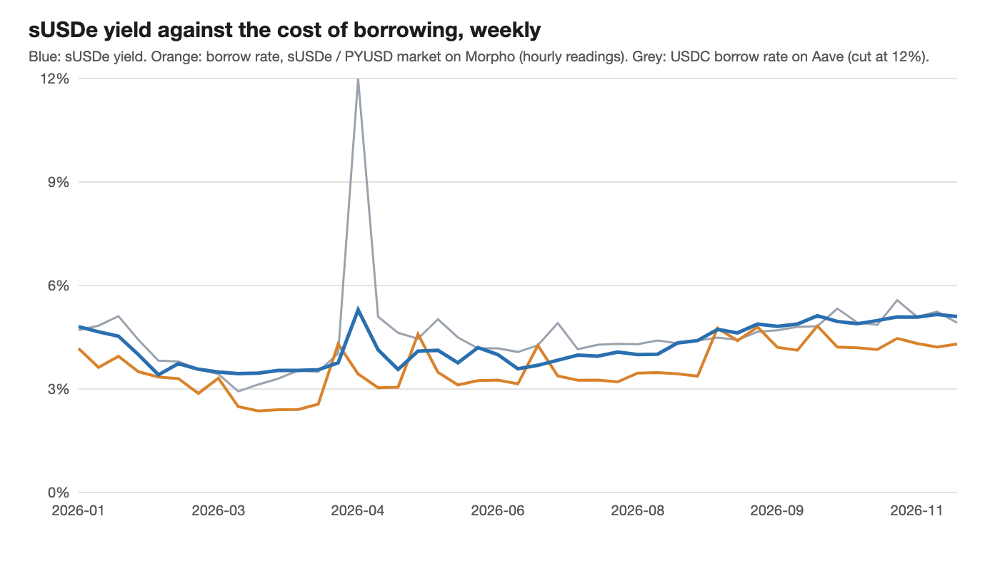
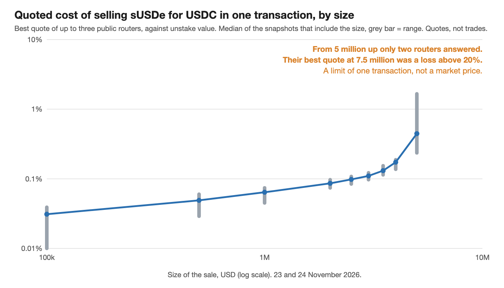

# How holders leave a leveraged sUSDe position

Since January 2026, about 494 million USD of sUSDe has been withdrawn from the largest sUSDe lending market on Morpho, at today's rate. The addresses that received it started Ethena unstakes worth 33% or 40% of it within three days, by two counting rules. They sold sUSDe worth 5% or 6% of it on a DEX (a decentralized exchange) or through CoW in the same three days, matched by address, not by coin.

## The system

USDe is Ethena's dollar token. sUSDe is staked USDe. It earns Ethena's yield, and it can be turned back into USDe at the contract rate by an unstake: a request, then a fixed wait. That rate, with 1 USDe counted as 1 USD, is the unstake value used here.

Morpho is a lending protocol on Ethereum. In its sUSDe / PYUSD market a holder posts sUSDe as collateral and borrows PYUSD, a dollar stablecoin. A loop repeats this: borrow, buy more sUSDe, post it, borrow again. A position at 7x holds 7 USD of sUSDe for each 1 USD of equity.

A position can be liquidated, meaning its collateral is sold to repay the loan, when the loan passes 91.5% of the collateral value. The value comes from an oracle, a contract that reads published prices. It multiplies the sUSDe contract rate by the USDe price in dollars published by Chainlink and divides by its PYUSD price. The market price of sUSDe does not enter. The price of USDe does.

## Where the loop wins

Over the 45 weeks from 13 January to 23 November 2026, the weekly sUSDe yield was below this market's borrow rate, taken hourly, in 4 weeks. The mean difference over all 45 weeks was 0.62 points, and 0.72 over the 41 weeks above. At the leverage implied by the market's mean loan-to-value, 7.4x, the formula gives a mean of 8.2% a year on equity. That is a formula on weekly means before any cost, not a position's return.

*sUSDe yield (blue), borrow rate of the sUSDe / PYUSD market on Morpho (orange), USDC borrow rate on Aave (grey, cut at 12%). Weekly means.*

## How holders left

The market's debt peaked at 163 million USD on 15 April 2026 and fell to 21 million by 15 August. In April and May, 222 million sUSDe was withdrawn. 4.8 million of it, 2%, left in a transaction that also sold sUSDe on a DEX.

84% of the withdrawn collateral left in a transaction that also repaid debt. That is mechanics: at these loan levels collateral cannot leave without a repayment. The ten largest receivers got 80% of all the withdrawn sUSDe.

The receiving addresses started Ethena unstakes worth 40% of the withdrawn sUSDe within three days, each address capped at what it received. A stricter counting rule, capped per day, gives 33%. By the same two rules, the receiving addresses sold 6% or 5% on a DEX or through CoW within three days. This matches amounts by address, not coins. An address that received 100 and unstaked 1 counts as 1, so this is not the share of sUSDe whose receiver unstaked.

None of the 91 repayments above 1 million PYUSD shows a flash loan event from Morpho, Aave v3 or Balancer v2. 42% of their value reached the payer in a transaction that bought PYUSD on a DEX in the 24 hours before. The rest came by mint, borrow or transfer, not traced further.

On hourly rates the yield stayed above the borrow rate in 15 of the 18 weeks of the fall. One of the three weeks below, ending 18 May, is the week debt fell by 56 million. Ten addresses, not necessarily the same ten as the receivers, cut 161 million PYUSD of debt between them, counted from events, and each had less than 5% of its April debt left at the August low. Their collateral was not checked, and one of them borrowed more than 1 million again later. All addresses whose debt fell cut 162.5 million. Other addresses added 21 million of debt, so the net fall in PYUSD was 142 million. That 21 million is not the 21 million USD of the low. The two largest falls in that period began within 13 hours of supply dropping by 18 to 24 million USD, nearly all the idle liquidity, withdrawn by one vault in April and two in May, all run by one curator. Utilization, debt over supply, reached about 100% and the hourly borrow rate went from under 3% to over 10% for some hours. This is timing, not cause. A fall in March, before the peak and larger than the April one, came with no such jump.

From April to August the worst hourly median price of sUSDe against USDe on DEXs was 8 bp (0.08%) below unstake value. The market has had one liquidation and no loss left to lenders.

## Where it can lose

**Routers quoted a small loss up to about 3 million in one transaction.** Three public routers were asked to price a sale of sUSDe for USDC in one transaction. The median best quote was 6 bp at 1 million and 11 bp at 3 million. At 4 million it was 17 bp, but in two of seven snapshots that rests on the CoW estimate alone, and the only other quote there lost about 10.4% and 10.9%. From 5 million up only two answered, and at 7.5 million the best quote was a loss above 20%. That reads as a limit of one transaction, not a market price. These are quotes, not trades.

*Quoted cost of one sale into USDC against unstake value, by size, up to 5 million USD. Log scales.*

**Leverage multiplies a discount.** A 1% discount on the sUSDe sold costs 7.4% of the equity at 7.4x.

**Liquidation follows the USDe price.** On 22 November a 5% fall in the oracle's price ratio, USDe against PYUSD on the Chainlink prices, would put 41% of the debt at liquidation, a 2% fall 3%. The mean distance to liquidation, weighted by debt, was 5.3%. Since the market opened, the oracle's price ratio never fell more than 0.6%. The feed has not been tested.

**The unstake wait is Ethena's decision.** It went from 90 to 7 days in November 2023 and to 1 day on 16 March 2026. The contract sets a maximum of 90 days and no rule for changing it.

## What is at stake

19 positions hold more than 10,000 USD of debt. The ten largest today hold 94% of it.

The exit seen in the record is a repayment in PYUSD that reached the payer in the day before. The receiving addresses then started unstakes worth 33% or 40% of the freed sUSDe. That path needs PYUSD in hand and a short unstake wait. The USDe it gives still has to be sold.

## What this does not show

The quotes come from 23 and 24 November. The order of events is not a cause. The exit data counts withdrawals, not closed positions. The market is 11 months old.

## Predictions

Written before the first data pull, on the author's word: the file has no independent timestamp. 14 could be scored and 7 held. The kill condition on the number of positions fired, and the study went on.

Numbers, queries and code: the README of the repository.
